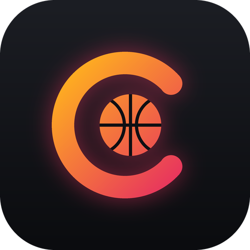
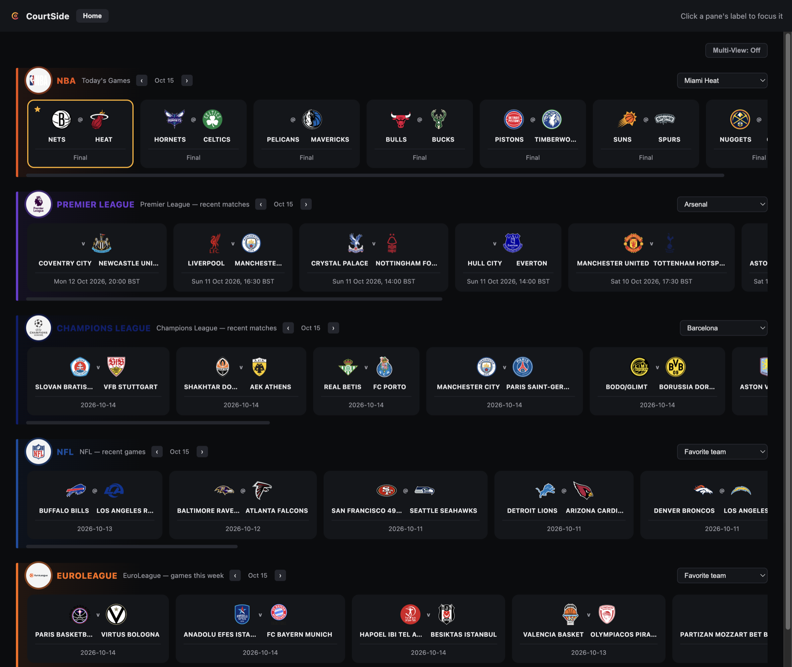
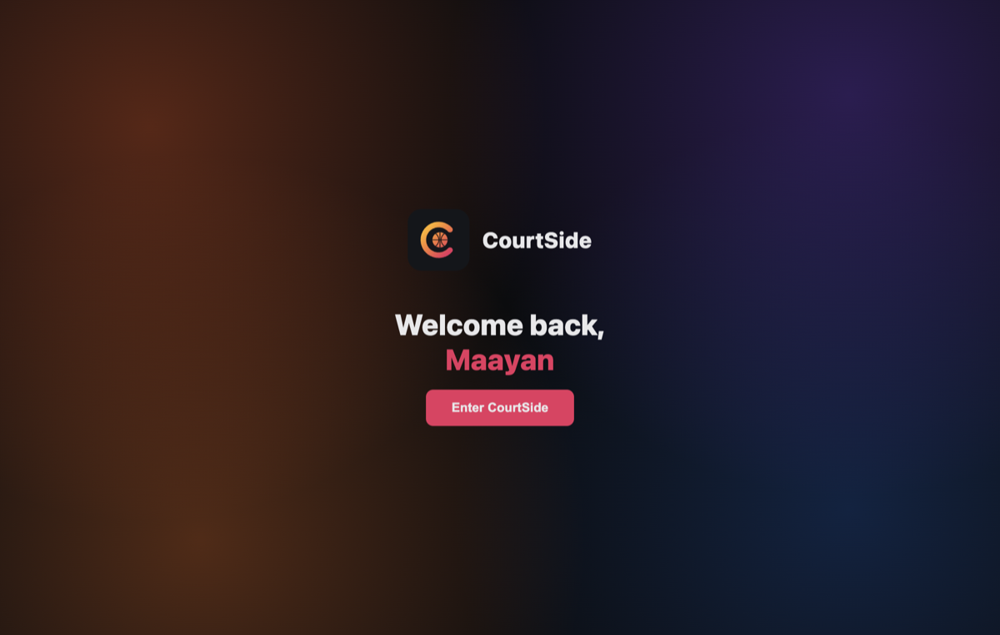
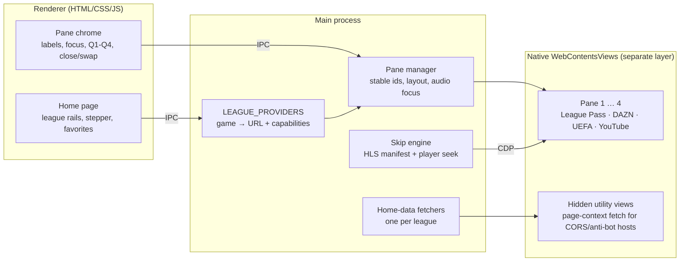

<div align="center">



# CourtSide

**One desktop app for every game you follow, with a spoiler-safe way to jump straight to the quarter that matters.**

Electron · macOS · NBA · Premier League · Champions League · NFL · EuroLeague

</div>

<p align="center">
  
</p>

> **Work in progress.** The core flows work end to end, but some pieces are still rough. See [Known limitations](#known-limitations-work-in-progress) and the [roadmap](#roadmap).

CourtSide is a personal desktop shell that puts several sports-streaming subscriptions behind one interface. You browse every league's games in one place, press a game, and it opens in the right service, already on the right game. Up to four can play side by side.

It exists because of a specific annoyance: watching NBA League Pass replays the morning after a game (Israel time zone) and wanting to skip to the 4th quarter without seeing the score or a runtime that gives away overtime.

## Features

- **One home page, five leagues.** A horizontally scrolling rail of game cards per league, each with its logo and accent color. Scores are deliberately never shown.
- **Press a game, watch that game.** Each league routes to the service that carries it and lands on the specific game or highlight.
- **Multi-view grid.** Open up to four games at once. Each pane can be closed, swapped, or added to independently, and exactly one pane has audio and controls at a time (click its label to move focus).
- **Spoiler-safe skip to quarter (NBA League Pass).** Q1-Q4 buttons seek a replay to the start of a quarter without ever rendering the scoreboard, plus nudge buttons for fine adjustment.
- **Favorite team per league**, highlighted on the home page and remembered between launches.
- **Browse any date.** A previous/next stepper per league (days for the NBA, weeks for the rest). A league that is out of season opens on its last real games instead of an empty page.
- **A welcome flow.** It asks for your name once and greets you on every launch.

<p align="center">
  
</p>

## What each league does

| League | Games and schedule from | What opens when you press a game |
|---|---|---|
| NBA | NBA CDN + stats API | The full replay on NBA League Pass, with Q1-Q4 skip buttons |
| Premier League | Premier League's own match API | Official highlights on the home club's YouTube channel |
| Champions League | ESPN scoreboard | Match highlights on uefa.com (needs a UEFA login) |
| NFL | ESPN scoreboard | DAZN Game Pass "Short Highlights" (free). "Full Game" is shown locked, matching DAZN's own UI |
| EuroLeague | EuroLeague's own feed | The matching video on the official EuroLeague YouTube channel |

You log in to each service yourself, inside its own pane, with your own account. Nothing is merged across accounts and CourtSide never sees your credentials.

## How it works



The video panes are native `WebContentsView`s positioned by the main process, a completely separate layer from the renderer's DOM. Each one is a real, unmodified browser session with its own cookies, login and DRM negotiation.

A few of the more interesting problems this solved (the full account is in [docs/DESIGN_LOG.md](docs/DESIGN_LOG.md)):

- **Skip without pixels.** Widevine blocks screen capture of decoded video on macOS, so the original computer-vision plan was impossible. Instead the app reads structural `#EXT-X-DISCONTINUITY` markers from the HLS manifest (captured through the Chrome DevTools Protocol `Fetch` domain, since replaying the request gets rejected) and seeks through the video player's own API, found via React's fiber tree.
- **Choosing the right break.** Gap size is unreliable (a mid-quarter timeout can outlast a short halftime), so the halftime guess uses the middle discontinuity by count, which landed exactly on Q3's start in 7 of 8 real games and within one nudge on all 8.
- **Data sources that fight back.** `stats.nba.com` silently hangs for a Node `fetch`, so requests run inside a page context (`fetchViaPage`). PulseLive checks the `Origin` header, so each league family gets its own hidden utility view. ESPN's `teams` endpoint sends no CORS header at all, so that roster is hardcoded.
- **Automation that survives modern sites.** Highlight lookups drive real pages built on shadow DOM (UEFA's Stencil components, YouTube's Lit components), so the scripts walk shadow roots, match only real title elements to avoid cross-card false positives, and dispatch a full pointer/mouse event sequence for sites that ignore a plain `click()`.
- **A throttling gotcha.** Hiding a pane at 0×0 or off-screen made Chromium throttle it like a background tab, so heavy single-page apps never finished loading during scripted navigation. Leaving the pane genuinely visible fixed two long-standing intermittent failures.

## Known limitations (work in progress)

CourtSide is under active development. These are the open problems, and where each one stands:

| Limitation | Status |
|---|---|
| **Q2 and Q4 skip are coarse.** Only Q3 (halftime) is a hard broadcast break, so Q2/Q4 land near the boundary and need a nudge. An index offset and anchoring to NBA play-by-play wall-clock times were both tried and failed for real reasons (see the design log). | 🔧 Working on it. A proper fix needs to know how much time a replay was trimmed from the live broadcast. |
| **Some broadcasts have no skip markers** (a 2026 Finals game had none), so the buttons stay disabled. | 🔍 Investigating which broadcasts are affected and why. |
| **NFL playback is flaky.** DAZN's highlight player sometimes fails with a DRM (CDM) error. The click-through itself works. | 🔧 Working on it. The failure is intermittent, so the first step is a reliable reproduction. |
| **One EuroLeague game** (Real Madrid v Hapoel Tel Aviv) doesn't match its video, because the video's title uses a different short name. | 🔧 Working on it. |
| **macOS only,** and desktop only by necessity. | Not planned. |

## Running it

CourtSide uses the [castlabs Electron fork](https://github.com/castlabs/electron-releases) because stock Electron ships no Widevine CDM. Real DRM services (League Pass, DAZN) reject the CDM until the packaged app is signed through castlabs' free EVS (Electron Verified Signing) service, so `npm start` will not play commercial streams. You need a signed, packaged build.

```bash
npm install
python3 -m venv .evs-venv && .evs-venv/bin/pip install castlabs-evs
.evs-venv/bin/evs-account signup      # one-time EVS account (credentials live in ~/.config/evs)
npm run build:mac                     # package + VMP-sign + ad-hoc codesign
npm run open                          # launch dist/mac-arm64/CourtSide.app
```

You also need your own subscriptions or logins for whichever services you want to use (NBA League Pass, DAZN, a UEFA account). Anything that is free, like the EPL, EuroLeague and NFL highlights, works without one.

## Roadmap

| Version | Scope | Status |
|---|---|---|
| v0.1 | Single-service shell, DRM playback, skip to second half | Done |
| v0.2 | Two panes, focus-follows-audio, Q1-Q4 buttons | Done |
| v0.3 | Home page with real schedules and favorite team | Done |
| v0.4 | Dynamic multi-view grid, five leagues, home page redesign | Done |
| v0.5 | Formal provider interface (capabilities per service) | Next |
| v0.6 | Hide-scores toggle | Planned |
| v0.7 | "What to watch" recommendations, weighted by favorite team | Planned |
| v1.0 | Depth pass: saved layouts, hover-audio, more services, polish | Planned |

## Disclaimer

An independent personal project, not affiliated with or endorsed by any league or streaming service. All team names, logos and trademarks belong to their owners. CourtSide does not bypass blackouts, merge accounts, or circumvent any service's access controls: each embedded session is the normal website with your own login.

## Docs

- [Design log](docs/DESIGN_LOG.md): the full chronological engineering account, including the dead ends.
